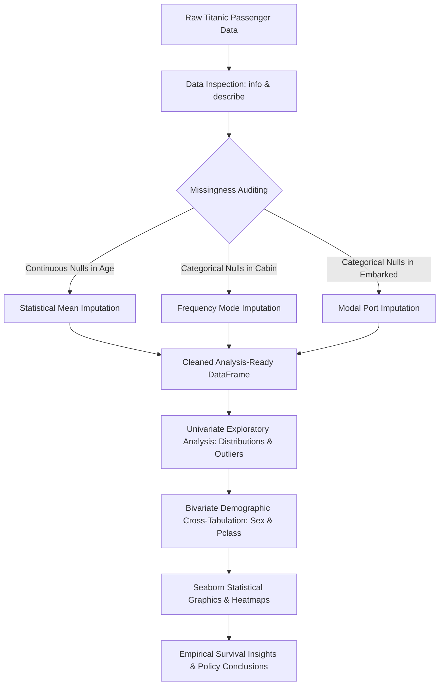

<div align="center">


[](https://www.python.org/)
[](https://pandas.pydata.org/)
[](https://seaborn.pydata.org/)
[](https://matplotlib.org/)
[](https://jupyter.org/)
[](#)

</div>

---

## 📌 Executive Summary / Overview

The **Statistical Data Science Lab I** (`personals`) repository presents an empirical exploratory data analysis (EDA) and missingness treatment framework applied to historical maritime survival data (the Titanic dataset). Developed under the curriculum of Statistical Data Science (SDS), the project demonstrates disciplined exploratory workflows essential for reproducible data preparation.

Maritime survival outcomes exhibit significant demographic and socio-economic skew. This laboratory investigation isolates primary survival predictors—socio-economic passenger class (`Pclass`), biological sex (`Sex`), age brackets, and fare distribution—while rigorously resolving data quality issues such as non-random missingness in `Age`, `Cabin`, and `Embarked` features.

---

## 📖 Interactive Table of Contents

- [Executive Summary / Overview](#-executive-summary--overview)
- [Key Features & Capabilities](#-key-features--capabilities)
- [System Architecture & Analytical Workflow](#-system-architecture--analytical-workflow)
- [Tech Stack Breakdown](#-tech-stack-breakdown)
- [Data Cleaning & Imputation Strategy](#-data-cleaning--imputation-strategy)
- [Reproducible Quickstart & Setup](#-reproducible-quickstart--setup)
- [Project Directory Layout](#-project-directory-layout)
- [Author & Contributions](#-author--contributions)

---

## ✨ Key Features & Capabilities

- **Automated Missingness Remediation**: Systematically scans missing rates, applying numerical mean imputation for continuous features (`Age`) and categorical mode imputation for discrete variables (`Cabin`, `Embarked`).
- **Demographic Survival Disparity Profiling**: Evaluates the statistical impact of the "women and children first" maritime evacuation protocol through univariate and bivariate contingency comparisons.
- **Socio-Economic Gradient Analysis**: Quantifies survival odds disparities between first-class, second-class, and third-class ticket holders relative to fare magnitude.
- **Seaborn Statistical Visualizations**: Deploys distribution curves, grouped countplots, boxplots, and categorical factor plots examining cross-feature interactions.
- **Parametric Descriptive Statistics**: Summarizes skewness, variance, interquartile ranges, and central tendencies across passenger subsets.

---

## 🏗️ System Architecture & Analytical Workflow



---

## 🛠️ Tech Stack Breakdown

| Category | Technologies & Tools |
| :--- | :--- |
| **Language** | Python 3.9+ |
| **Data Manipulation** | Pandas (DataFrames, Missingness Imputation, GroupBy) |
| **Scientific Library** | NumPy (Array manipulation and vector math) |
| **Statistical Graphics** | Seaborn, Matplotlib |
| **Interactive Notebook**| Jupyter Notebook (`SDS 1 (1).ipynb`) |

---

## 🔬 Data Cleaning & Imputation Strategy

| Feature | Missing Count | Imputation Strategy | Justification |
| :--- | :--- | :--- | :--- |
| `Age` | High | Mean Imputation (`titanic['Age'].fillna(mean)`) | Retains sample size without introducing systematic directional bias |
| `Cabin` | Very High | Modal String Imputation (`titanic['Cabin'].mode()[0]`) | Normalizes categorical missingness for string parsing |
| `Embarked` | Minimal (2) | Modal Port Imputation (`titanic['Embarked'].mode()[0]`)| Replaces rare unrecorded ports with most probable embarkation hub |

---

## 🚀 Reproducible Quickstart & Setup

### Prerequisites
- Python 3.9+
- Jupyter Notebook / Jupyter Lab

### Installation
```bash
# Clone the repository
git clone https://github.com/Jeshwanthika07/personals.git
cd personals

# Create virtual environment
python -m venv venv
# On Windows:
.\venv\Scripts\activate
# On Linux/macOS:
source venv/bin/activate

# Install dependencies
pip install numpy pandas matplotlib seaborn jupyterlab
```

### Launch the Notebook
```bash
jupyter lab "SDS 1 (1).ipynb"
```

---

## 📂 Project Directory Layout

```text
personals/
│
├── SDS 1 (1).ipynb            # Comprehensive 26-cell statistical EDA & imputation pipeline
└── README.md                  # Detailed laboratory documentation and methodology
```

---

## 👩‍💻 Author & Contributions

Authored by **[Jeshwanthika Pothamchetty](https://github.com/Jeshwanthika07)**  
*Alliance University | Department of Computer Applications*

<div align="center">


</div>
